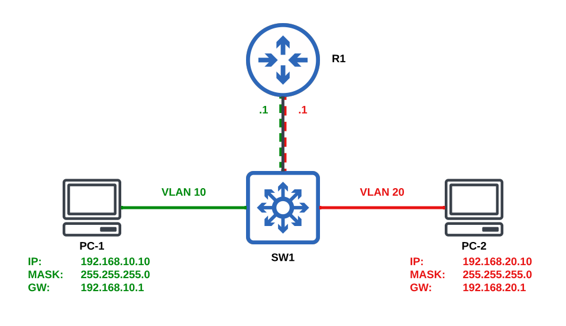
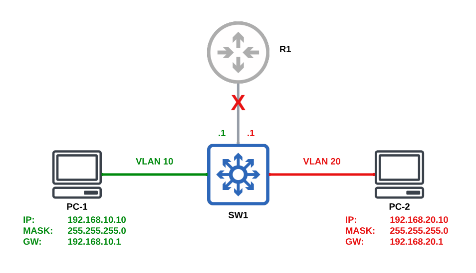

# Inter-VLAN Routing (IVR)

## Router-on-a-Stick



### Task 1. Create VLAN 10 on SW1
### Task 2. Assign PC-1's switchport to VLAN 10

```text
# SW1
configure terminal
vlan 10
 exit

interface Ethernet0/2
 switchport
 switchport mode access
 switchport access vlan 10
end
```


### Task 3. Create VLAN 20 on SW1
### Task 4. Assign PC-2's switchport to VLAN 20

```text
# SW1
configure terminal
vlan 20
 exit

interface Ethernet0/3
 switchport
 switchport mode access
 switchport access vlan 20
end
```

### Task 5. Configure SW1's port toward R1 as an 802.1Q trunk

```text
# SW1
configure terminal
interface Ethernet0/1
 switchport
 switchport trunk encapsulation dot1q
 switchport mode trunk
end
```

### Task 6. Configure R1 for inter-VLAN routing

```text
# R1
configure terminal
interface Ethernet0/1
 no shutdown

interface Ethernet0/1.10
 encapsulation dot1q 10
 ip address 192.168.10.1 255.255.255.0
 no shutdown

interface Ethernet0/1.20
 encapsulation dot1q 20
 ip address 192.168.20.1 255.255.255.0
 no shutdown
end
```

### Verification from PC-1

```text
# PC-1
ping -c5 192.168.20.10
arp -n
```

## Switched Virtual Interface



### Task 7. Move Routing to SW1 Using SVIs

Disable the routed trunk connection to R1 and move inter-VLAN routing to SW1.

```text
# SW1
configure terminal
interface Ethernet0/1
 shutdown

interface Vlan10
 ip address 192.168.10.1 255.255.255.0
 no shutdown

interface Vlan20
 ip address 192.168.20.1 255.255.255.0
 no shutdown

ip routing
end
```

### Verification from PC-1

```text
# PC-1
ping -c5 192.168.20.10
arp -n
```

## Key Concepts

Inter-VLAN routing allows devices in different VLANs to communicate by routing traffic between separate Layer 2 broadcast domains.

This lab demonstrates two common methods of implementing inter-VLAN routing:

* **Router-on-a-Stick (Tasks 1–6)** uses a single physical router interface configured as an **802.1Q trunk**. The router creates one **subinterface per VLAN**, and each subinterface is assigned an IP address that serves as the default gateway for its VLAN. Traffic between VLANs traverses the trunk to the router, is routed between subinterfaces, and is sent back down the same trunk to the destination VLAN.

* **Switched Virtual Interfaces (Task 7)** move the routing function to a **Layer 3 switch**. Instead of using router subinterfaces, the switch creates an **SVI** for each VLAN using `interface Vlan<id>`. Enabling `ip routing` allows the switch to route traffic directly between VLANs.

Although both approaches provide the same result, communication between VLAN 10 and VLAN 20, they differ in where Layer 3 forwarding occurs. Router-on-a-Stick performs routing on an external router, while an SVI-based design performs routing directly on the multilayer switch.
