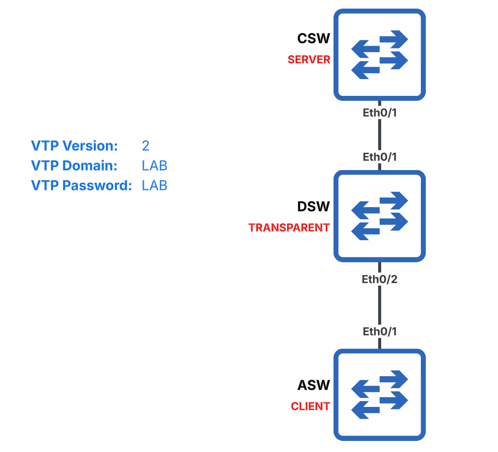

# VLAN Trunking Protocol (VTP)



### Task 1. Statically configure all links as 802.1Q trunks

```text
# CSW
configure terminal
interface Ethernet0/1
 no shutdown
 switchport
 switchport trunk encapsulation dot1q
 switchport mode trunk
end
```

```text
# DSW
configure terminal
interface range Ethernet0/1 - 2
 no shutdown
 switchport
 switchport trunk encapsulation dot1q
 switchport mode trunk
end
```

```text
# ASW
configure terminal
interface Ethernet0/1
 no shutdown
 switchport
 switchport trunk encapsulation dot1q
 switchport mode trunk
end
```

### Task 2. Configure CSW as a VTPv2 server

```text
# CSW
configure terminal
vtp version 2
vtp mode server
end
```

### Task 3. Configure DSW as VTPv2 transparent

```text
# DSW
configure terminal
vtp version 2
vtp mode transparent
end
```

### Task 4. Configure ASW as a VTPv2 client

```text
# ASW
configure terminal
vtp version 2
vtp mode client
end
```

### Task 5. Configure the VTP domain name and password

Configure the domain name and password as `LAB`.

```text
# CSW, DSW & ASW
configure terminal
vtp domain LAB
vtp password LAB
end
```

#### Verification

```text
# CSW, DSW & ASW
show vtp status | include version running|Domain
show vtp password
```

### Task 6. Ensure VLANs 10, 20, and 30 exist on all switches

Create VLANs 10, 20, and 30 on CSW and DSW.

```text
# CSW & DSW
configure terminal
vlan 10,20,30
end
```

#### Verification

```text
# CSW, DSW & ASW
show vlan brief
show vtp status | include Revision
```

## Key Concepts

VTP, or **VLAN Trunking Protocol**, allows switches in the same VTP domain to distribute VLAN information across 802.1Q trunk links.

This lab demonstrates the three VTP operating modes:

* **VTP Server (CSW)** can create, modify, and delete VLANs for the VTP domain. These VLAN changes are advertised to other switches in the domain.
* **VTP Transparent (DSW)** maintains its own local VLAN database and forwards VTP advertisements, but it does not synchronize its VLAN database with the domain.
* **VTP Client (ASW)** learns VLAN information from the VTP domain but cannot create, modify, or delete VLANs locally.

VLANs 10, 20, and 30 are created on the VTP server and propagated to the client through the transparent switch. Verification confirms that all switches have the expected VLANs and VTP revision information.
