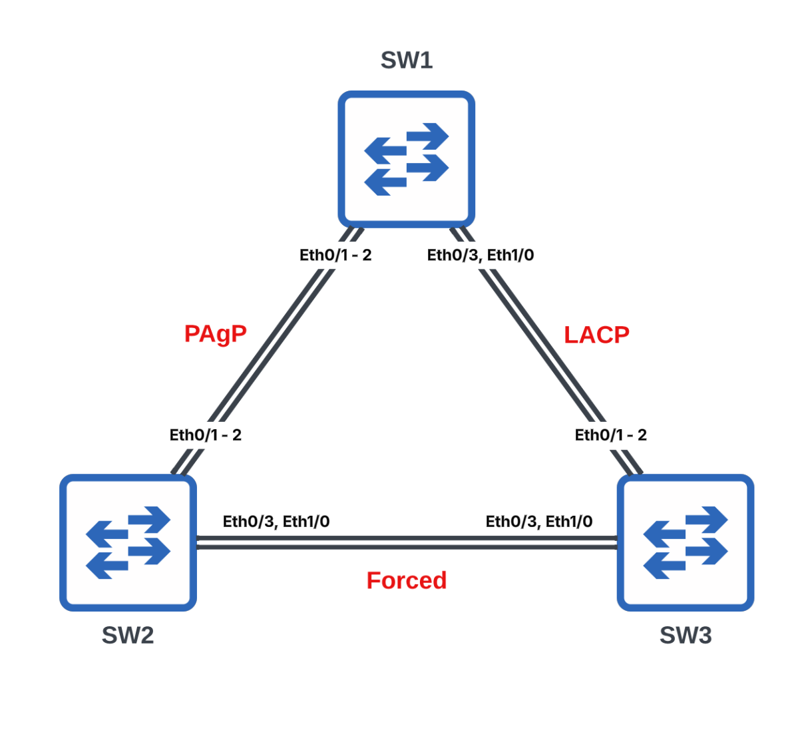

# Link Aggregation (LAG)



### Task 1. Configure PAgP between SW1 and SW2

Configure SW1 to actively negotiate the EtherChannel using PAgP.

```text
# SW1
configure terminal
interface Ethernet0/1
 channel-group 12 mode desirable

interface Ethernet0/2
 channel-group 12 mode desirable

interface Port-channel12
 switchport trunk encapsulation dot1q
 switchport mode trunk
end
```

```text
# SW2
configure terminal
interface Ethernet0/1
 channel-group 12 mode auto

interface Ethernet0/2
 channel-group 12 mode auto

interface Port-channel12
 switchport trunk encapsulation dot1q
 switchport mode trunk
end
```

---

### Task 2. Configure LACP between SW1 and SW3

Configure SW1 to actively negotiate the EtherChannel using LACP.

```text
# SW1
configure terminal
interface range Ethernet0/3 , Ethernet1/0
 channel-group 13 mode active

interface Port-channel13
 switchport trunk encapsulation dot1q
 switchport mode trunk
end
```

```text
# SW3
configure terminal
interface range Ethernet0/1 - 2
 channel-group 13 mode passive

interface Port-channel13
 switchport trunk encapsulation dot1q
 switchport mode trunk
end
```

---

### Task 3. Configure a static EtherChannel between SW2 and SW3

Configure a static EtherChannel without a negotiation protocol.

```text
# SW2
configure terminal
interface range Ethernet0/3 , Ethernet1/0
 channel-group 23 mode on

interface Port-channel23
 switchport trunk encapsulation dot1q
 switchport mode trunk
end
```

```text
# SW3
configure terminal
interface range Ethernet0/3 , Ethernet1/0
 channel-group 23 mode on

interface Port-channel23
 switchport trunk encapsulation dot1q
 switchport mode trunk
end
```

---

### Task 4. Change the EtherChannel load-balancing algorithm

Configure all switches to load-balance traffic based on the destination MAC address.

```text
# SW1, SW2 & SW3
configure terminal
port-channel load-balance dst-mac
end
```

---

## Key Concepts

Link Aggregation (LAG), commonly called **EtherChannel** on Cisco devices, combines multiple physical Ethernet links into a single logical interface. This increases available bandwidth while providing redundancy if a member link fails.

This lab demonstrates three methods of forming an EtherChannel:

* **PAgP (Port Aggregation Protocol)** is Cisco proprietary. In this lab, SW1 uses **desirable** mode to actively negotiate an EtherChannel with SW2, which uses **auto** mode.
* **LACP (Link Aggregation Control Protocol)** is the IEEE 802.3ad/802.1AX standard. SW1 uses **active** mode to negotiate an EtherChannel with SW3, which uses **passive** mode.
* **Static EtherChannel** uses `mode on` and forms a bundle without any negotiation protocol. Both ends must be configured identically.

Once an EtherChannel is established, the member interfaces operate as a single logical **Port-channel** interface. Traffic is distributed across the physical links according to the configured load-balancing algorithm, which is changed in this lab to use the destination MAC address.
