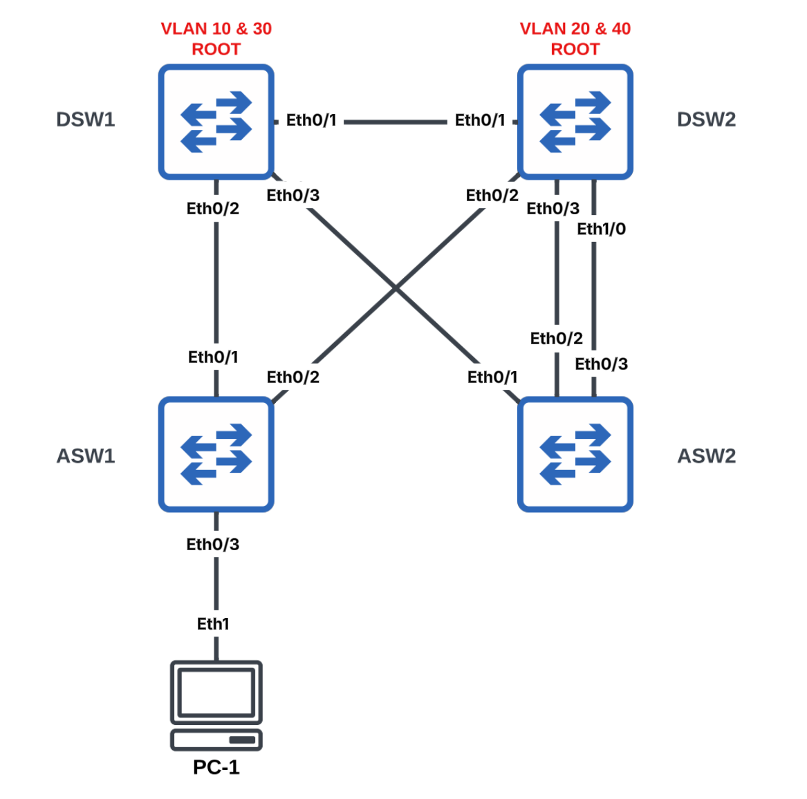
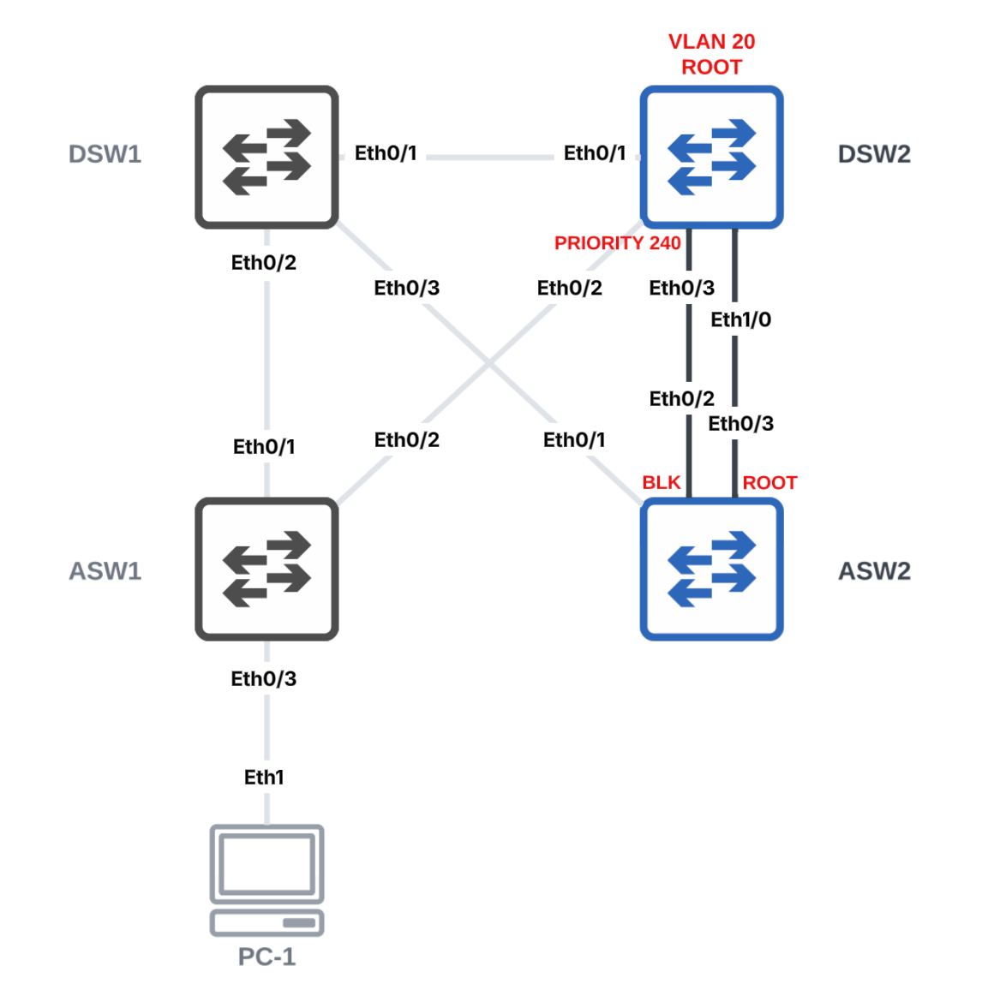
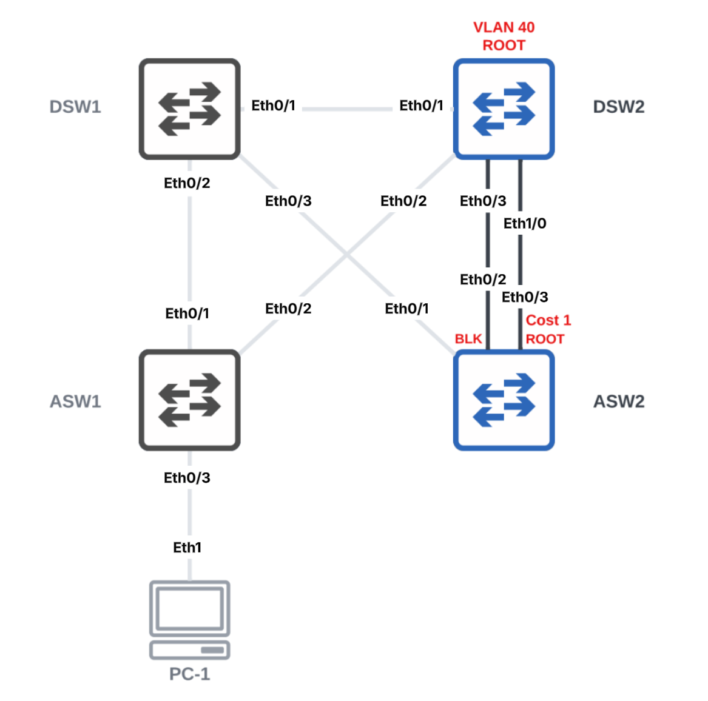
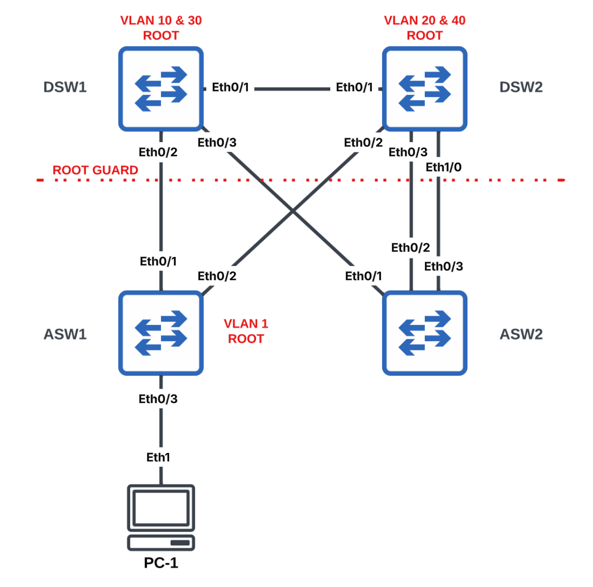

# Rapid Spanning Tree Protocol (RSTP)



## Root Bridge Selection

### Task 1. Configure all interswitch links as 802.1Q Trunks & host-facing ports as Access

```text
# DSW1
configure terminal
interface range Ethernet0/1 - 3
 switchport
 switchport trunk encapsulation dot1q
 switchport mode trunk
 no shutdown
end
```

```text
# DSW2
configure terminal
interface range Ethernet0/1 - 3, Ethernet1/0
 switchport
 switchport trunk encapsulation dot1q
 switchport mode trunk
 no shutdown
end
```

```text
# ASW1
configure terminal
interface range Ethernet0/1 - 2
 switchport
 switchport trunk encapsulation dot1q
 switchport mode trunk
 no shutdown

interface Ethernet 0/3
 switchport
 switchport mode access
 no shutdown
end
```

```text
# ASW2
configure terminal
interface range Ethernet0/1 - 3
 switchport
 switchport trunk encapsulation dot1q
 switchport mode trunk
 no shutdown
end
```

### Task 2. Create VLANs 10, 20, 30 & 40 on all switches

```text
# DSW1, DSW2, ASW1 & ASW2
configure terminal
vlan 10,20,30,40
end
```


### Task 3. Enable Rapid PVST+ on all switches

```text
# DSW1, DSW2, ASW1 & ASW2
configure terminal
spanning-tree mode rapid-pvst
end
```


### Task 4. Configure DSW1 as the root bridge for VLAN 10 and DSW2 as the backup

Use the `spanning-tree root` command.

```text
# DSW1
configure terminal
spanning-tree vlan 10 root primary
end
```

```text
# DSW2
configure terminal
spanning-tree vlan 10 root secondary
end
```


### Task 5. Configure DSW2 as the root bridge for VLAN 20 and DSW1 as the backup

Use the `spanning-tree root` command.

```text
# DSW2
configure terminal
spanning-tree vlan 20 root primary
end
```

```text
# DSW1
configure terminal
spanning-tree vlan 20 root secondary
end
```


### Task 6. Configure DSW1 as the root bridge for VLAN 30 and DSW2 as the backup

Use the `spanning-tree priority` command.

```text
# DSW1
configure terminal
spanning-tree vlan 30 priority 4096
end
```

```text
# DSW2
configure terminal
spanning-tree vlan 30 priority 8192
end
```


### Task 7. Configure DSW2 as the root bridge for VLAN 40 and DSW1 as the backup

Use the `spanning-tree priority` command.

```text
# DSW2
configure terminal
spanning-tree vlan 40 priority 4096
end
```

```text
# DSW1
configure terminal
spanning-tree vlan 40 priority 8192
end
```

## STP Timers

### Task 8. Configure VLAN 10's hello timer

Set the hello timer for VLAN 10 to 4 seconds.

```text
# DSW1
configure terminal
spanning-tree vlan 10 hello-time 4
end
```

## Root Port Selection

### Task 9. Ensure ASW2's Ethernet0/3 is selected as the root port for VLAN 20.

Use port priority to influence root port selection



```text
# DSW2
configure terminal
interface Ethernet0/3
 spanning-tree vlan 20 port-priority 240
end
```

---

### Task 10. Ensure ASW2's Ethernet0/3 is selected as the root port for VLAN 40.

Use path cost to influence root port selection



```text
# ASW2
configure terminal
interface Ethernet0/3
 spanning-tree vlan 40 cost 1
end
```


## Root Guard

### Task 11. Protect the distribution switches with Root Guard

Prevent DSW1 and DSW2 from accepting superior BPDUs from the access switches.



```text
# DSW1
configure terminal
interface range Ethernet0/2 - 3
 spanning-tree guard root
end
```

```text
# DSW2
configure terminal
interface range Ethernet0/2 - 3, Ethernet1/0
 spanning-tree guard root
end
```

Verify Root Guard by making ASW1 advertise itself as the root bridge.

```text
# ASW1
configure terminal
spanning-tree vlan 1 priority 0
end
```

## VLAN Allow Lists

### Task 12. Only allow VLANs 10, 20, 30 & 40 on DSW1 & 2 Trunks

```text
# DSW1
configure terminal
interface range Ethernet0/1 - 3
 switchport trunk allowed vlan 10,20,30,40
end
```

```text
# DSW2
configure terminal
interface range Ethernet0/1 - 3, Ethernet1/0
 switchport trunk allowed vlan 10,20,30,40
end
```

## Portfast and BPDU Guard

### Task 13. Configure PortFast and BPDU Guard

Configure PC-1's access port to immediately transition to the forwarding state while protecting against accidental switch connections.

```text
# ASW1
configure terminal
interface Ethernet0/3
 shutdown
 spanning-tree portfast
 spanning-tree bpduguard enable
 no shutdown
end
```

---

## Key Concepts

Rapid Spanning Tree Protocol (RSTP), implemented by Cisco as **Rapid PVST+**, prevents Layer 2 switching loops while providing much faster convergence than the original IEEE 802.1D Spanning Tree Protocol. Rapid PVST+ maintains a separate spanning-tree instance for each VLAN.

This lab demonstrates several common RSTP features in the order they are typically configured:

* **Rapid PVST+** enables rapid spanning-tree convergence on Cisco switches while maintaining an independent spanning-tree topology for each VLAN.
* **Root Bridge Election** determines the logical center of the spanning-tree topology. Root bridges can be selected using the `root primary` and `root secondary` macros or by manually configuring bridge priority.
* **STP Timers** control how quickly spanning-tree messages are exchanged. The hello timer determines how frequently the root bridge sends BPDUs.
* **Root Port Selection** determines the preferred path toward the root bridge. Root port selection can be influenced by modifying the spanning-tree port priority or path cost.
* **Root Guard** prevents downstream switches from becoming the root bridge by placing a port into the root-inconsistent state if it receives a superior BPDU.
* **VLAN Allow Lists** restrict which VLANs are permitted across a trunk, reducing unnecessary traffic and limiting the Layer 2 failure domain.
* **PortFast** allows access ports connected to end devices to transition immediately to the forwarding state instead of progressing through the normal STP states.
* **BPDU Guard** protects PortFast interfaces by placing them into an err-disabled state if a BPDU is received, preventing accidental Layer 2 loops caused by connecting another switch to an access port.
