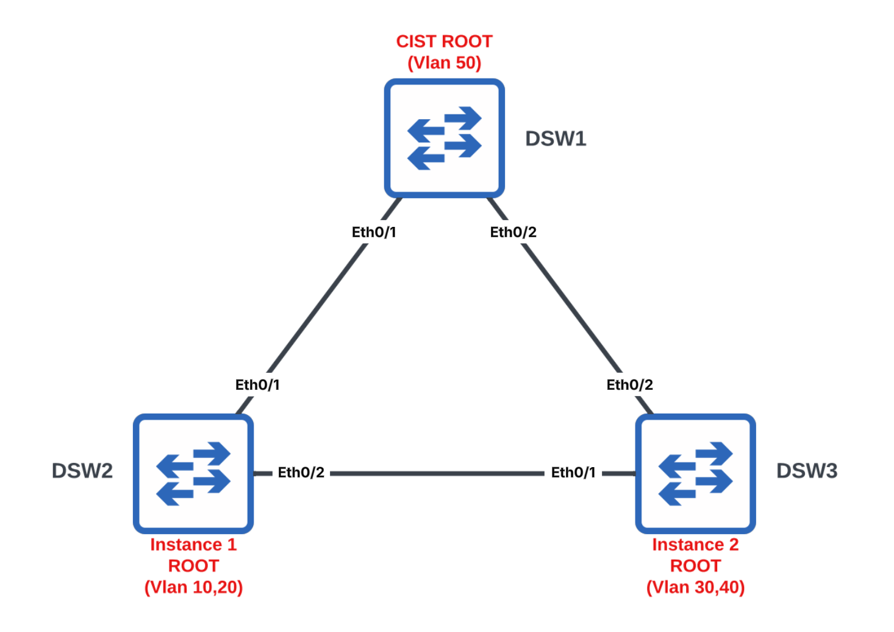
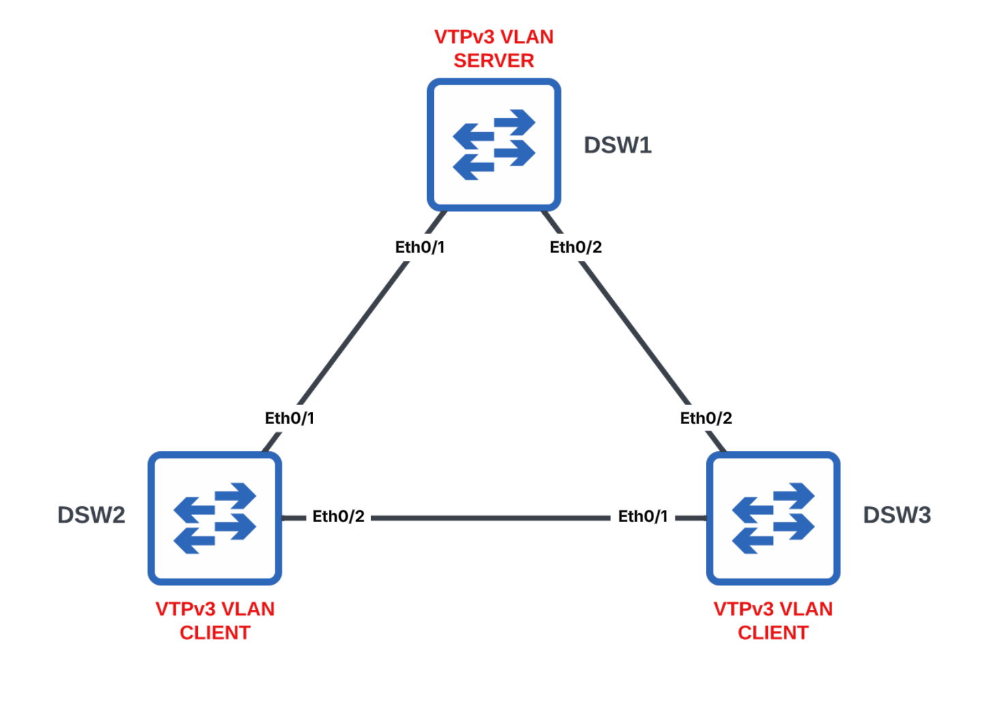

# Multiple Spanning Tree Protocol (MSTP)



## MST Region Configuration

### Task 1. Configure all ports as 802.1Q Trunks

```text
# DSW1, DSW2 & DSW3
configure terminal
interface range Ethernet0/1 - 2
 switchport
 switchport trunk encapsulation dot1q
 switchport mode trunk
 no shutdown
end
```

### Task 2. Create VLANs 10, 20, 30, 40, 50 & 60 on all switches

```text
# DSW1, DSW2 & DSW3
configure terminal
vlan 10,20,30,40,50,60
end
```


### Task 3. Configure VLANs 10 and 20 to use MST Instance 1

### Task 4. Configure VLANs 30 and 40 to use MST Instance 2

```text
# DSW1, DSW2 & DSW3
configure terminal
vlan 10,20,30,40

spanning-tree mst configuration
 name LAB
 revision 100
 instance 1 vlan 10,20
 instance 2 vlan 30,40
end
```

## Root Bridge Selection

### Task 5. Configure DSW1 as the root bridge for the CIST

```text
# DSW1
configure terminal
spanning-tree mst 0 priority 4096
end
```

### Task 6. Configure DSW2 as the root bridge for MST Instance 1

```text
# DSW2
configure terminal
spanning-tree mst 1 priority 4096
end
```

### Task 7. Configure DSW3 as the root bridge for MST Instance 2

```text
# DSW3
configure terminal
spanning-tree mst 2 priority 4096
end
```

## MSTP Operation

### Task 8. Convert all switches to MSTP

```text
# DSW1, DSW2 & DSW3
configure terminal
spanning-tree mode mst
end
```

## VTPv3 MST Distribution



### Task 9. Propagate future MSTP changes using VTPv3

Configure DSW2 and DSW3 as VTPv3 MST clients.

```text
# DSW2 & DSW3
configure terminal
vtp domain LAB
vtp version 3
vtp mode client mst
end
```

Configure DSW1 as the VTPv3 MST server and make it the primary server.

```text
# DSW1
configure terminal
vtp domain LAB
vtp version 3
vtp mode server mst
end

vtp primary mst
```

### Task 10. Configure VLANs 50 and 60 to use MST Instance 3

```text
# DSW1
configure terminal
spanning-tree mst configuration
 instance 3 vlan 50,60
end
```

## Key Concepts

Multiple Spanning Tree Protocol (MSTP) reduces the number of spanning-tree instances by allowing multiple VLANs to share the same Layer 2 topology.

This lab demonstrates the following MSTP technologies:

* **MST Instances** group VLANs that should use the same spanning-tree topology. VLANs 10 and 20 use Instance 1, VLANs 30 and 40 use Instance 2, and VLANs 50 and 60 use Instance 3.
* **MST Regions** consist of switches with matching region names, revision numbers, and VLAN-to-instance mappings.
* **Common and Internal Spanning Tree (CIST)** is MST Instance 0 and provides the common spanning-tree topology for the MST region.
* **Per-Instance Root Bridge Selection** allows each MST instance to use a different root bridge and Layer 2 forwarding path.
* **MST Mode** enables MSTP operation on the switches.
* **VTPv3 MST Distribution** propagates MST region configuration changes from the primary VTP server to the VTP clients.
