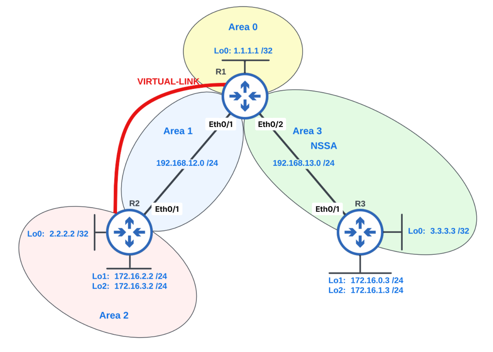

# Open Shortest Path First (OSPF)



## Multi-Area OSPF

### Task 1. Configure OSPF using Loopback0 addresses as router IDs

```text
# R1
configure terminal
router ospf 1
 router-id 1.1.1.1
 network 1.1.1.1 0.0.0.0 area 0
 network 192.168.12.1 0.0.0.0 area 1
 network 192.168.13.1 0.0.0.0 area 3
end
```

```text
# R2
configure terminal
router ospf 1
 router-id 2.2.2.2
 network 2.2.2.2 0.0.0.0 area 2
 network 172.16.2.2 0.0.0.0 area 2
 network 172.16.3.2 0.0.0.0 area 2
 network 192.168.12.2 0.0.0.0 area 1
end
```

```text
# R3
configure terminal
router ospf 1
 router-id 3.3.3.3
 network 3.3.3.3 0.0.0.0 area 3
 network 192.168.13.3 0.0.0.0 area 3
end
```

#### Verification

```text
# R1, R2 & R3
show ip ospf interface brief
show ip ospf neighbor
```

## OSPF Virtual Links

### Task 2. Provide Area 2 with connectivity to Area 0

Configure an OSPF virtual link between R1 and R2 through Area 1.

```text
# R1
configure terminal
router ospf 1
 area 1 virtual-link 2.2.2.2
end
```

```text
# R2
configure terminal
router ospf 1
 area 1 virtual-link 1.1.1.1
end
```

## NSSA and Route Summarization

### Task 3. Configure Area 3 as an NSSA

```text
# R1 & R3
configure terminal
router ospf 1
 area 3 nssa
end

show ip ospf topology-info topology
```

### Task 4. Redistribute R3's Loopback1 and Loopback2 interfaces into OSPF

### Task 5. Summarize R3's Loopback1 and Loopback2 routes

```text
# R3
configure terminal
router ospf 1
 redistribute connected subnets
 summary-address 172.16.0.0 255.255.254.0
end
```

#### Verification

```text
# R1
show ip route ospf
```

### Task 6. Summarize R2's Loopback1 and Loopback2 routes

```text
# R2
configure terminal
router ospf 1
 area 2 range 172.16.2.0 255.255.254.0
end
```

#### Verification

```text
# R1
show ip route ospf
```

## OSPF Loopback Network Types

### Task 7. Advertise the configured subnet masks for the loopback interfaces

```text
# R1, R2 & R3
configure terminal
interface Loopback0
 ip ospf network point-to-point
end
```

#### Verification

```text
# R1, R2 & R3
show ip ospf interface brief
show ip route ospf
```

## Connectivity Verification

### Task 8. Verify full connectivity

```text
# R1, R2 & R3
tclsh
foreach address {
192.168.12.1
192.168.12.2
192.168.13.1
192.168.13.3
1.1.1.1
2.2.2.2
3.3.3.3
172.16.0.3
172.16.1.3
172.16.2.2
172.16.3.2
} { ping $address repeat 1 timeout 2 }
tclquit
```

## OSPF Authentication

### Task 9. Configure MD5 authentication between physically connected neighbors

```text
# R1
configure terminal
interface range Ethernet0/1 - 2
 ip ospf message-digest-key 1 md5 pa55w0rd
 ip ospf authentication message-digest

router ospf 1
 area 1 authentication message-digest
 area 3 authentication message-digest
end
```

```text
# R2
configure terminal
interface Ethernet0/1
 ip ospf message-digest-key 1 md5 pa55w0rd
 ip ospf authentication message-digest

router ospf 1
 area 1 authentication message-digest
end
```

```text
# R3
configure terminal
interface Ethernet0/1
 ip ospf message-digest-key 1 md5 pa55w0rd
 ip ospf authentication message-digest

router ospf 1
 area 3 authentication message-digest
end
```

#### Verification

```text
# R1, R2 & R3
show ip ospf interface | include line|Cryptographic|Youngest
show ip ospf neighbor
```

## DR and BDR Election

### Task 10. Prevent R2 and R3 from being elected as the DR or BDR

```text
# R2 & R3
configure terminal
interface Ethernet0/1
 ip ospf priority 0
end

clear ip ospf process
yes
```

#### Verification

```text
# R1
show ip ospf interface brief
```

## Virtual-Link Authentication

### Task 11. Configure simple authentication on the virtual link

The existing virtual-link configuration may need to be removed before applying authentication.

```text
# R1
configure terminal
router ospf 1
 area 1 virtual-link 2.2.2.2 authentication authentication-key pa55w0rd
end
```

```text
# R2
configure terminal
router ospf 1
 area 1 virtual-link 1.1.1.1 authentication authentication-key pa55w0rd
end
```

#### Verification

```text
# R1 & R2
show ip ospf virtual-links
show ip ospf neighbor
```

## Totally NSSA

### Task 12. Ensure R3 receives only a default OSPF route

Configure Area 3 as a totally NSSA.

```text
# R1
configure terminal
router ospf 1
 area 3 nssa no-summary
end
```

#### Verification

```text
# R3
show ip route ospf
```

## Route-Controlled Redistribution

### Task 13. Use a route map to redistribute R3's loopbacks into OSPF

```text
# R3
configure terminal
route-map INTO_OSPF permit 10
 match ip address INTO_OSPF

route-map INTO_OSPF deny 100

ip access-list standard INTO_OSPF
 permit 172.16.0.0 0.0.0.255
 permit 172.16.1.0 0.0.0.255

router ospf 1
 redistribute connected subnets route-map INTO_OSPF
end

show ip access-list INTO_OSPF
show ip ospf database nssa-external self-originate
```

```text
# R1
show ip route ospf
```

## Key Concepts

OSPF is a link-state routing protocol that organizes routers into areas and calculates the shortest path to each destination using the OSPF link-state database.

This lab demonstrates the following OSPF technologies:

* **Router IDs** uniquely identify OSPF routers and are manually assigned using stable loopback addresses.
* **OSPF Areas** reduce the size of the link-state database and limit the scope of topology changes.
* **Virtual Links** logically connect a disconnected area to Area 0 through a transit area.
* **Not-So-Stubby Areas (NSSAs)** allow an area to import external routes while limiting other external advertisements.
* **Route Redistribution** imports routes from another source, such as connected interfaces, into OSPF.
* **Route Summarization** combines multiple routes into a single advertisement at an ABR or ASBR.
* **Loopback Network Type** allows OSPF to advertise a loopback's configured subnet mask instead of treating it as a host route.
* **OSPF Authentication** verifies neighboring routers using simple passwords or MD5 message-digest authentication.
* **DR and BDR Election** reduces OSPF adjacency requirements on broadcast networks. An interface priority of `0` prevents a router from becoming the DR or BDR.
* **Totally NSSA** limits internal routers to a default route while still permitting locally originated external routes.
* **Route Maps** provide policy control over which connected routes are redistributed into OSPF.
