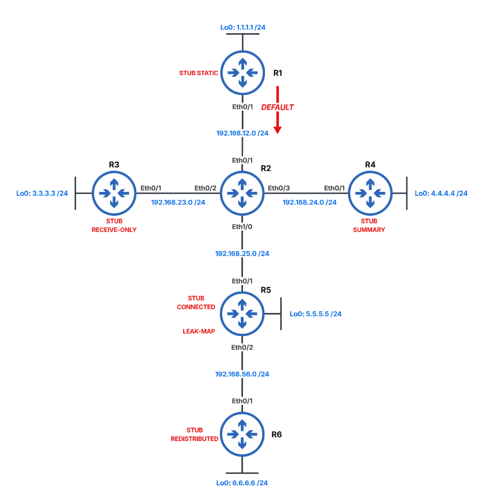

# Enhanced Interior Gateway Routing Protocol (EIGRP)



## EIGRP Configuration

### Task 1. Configure all routers for EIGRP AS 1 and advertise all networks

```text
# ALL ROUTERS
configure terminal
router eigrp 1
 no auto-summary
 network 0.0.0.0
end
```

## EIGRP Stub Routing

### Task 2. Configure R1 as a static stub

Configure R1 to advertise only a default route.

```text
# R1
configure terminal
ip route 0.0.0.0 0.0.0.0 Null0

router eigrp 1
 redistribute static
 eigrp stub static
end
```

#### Verification

```text
# R1
show ip eigrp topology
```

### Task 3. Configure R3 as a receive-only stub

Configure a static route on R2 so that R3's Loopback0 remains reachable.

```text
# R3
configure terminal
router eigrp 1
 eigrp stub receive-only
end
```

```text
# R2
configure terminal
ip route 3.3.3.0 255.255.255.0 192.168.23.3

router eigrp 1
 redistribute static
end
```

### Task 4. Configure R4 as a summary stub

Ensure that only the `4.4.0.0/16` summary is advertised into EIGRP.

```text
# R4
configure terminal
router eigrp 1
 eigrp stub summary

interface Ethernet0/0
 ip summary-address eigrp 1 4.4.0.0 255.255.0.0
end
```

### Task 5. Configure R6 as a redistributed stub

Redistribute connected routes so that R6's Loopback0 remains reachable.

```text
# R6
configure terminal
router eigrp 1
 eigrp stub redistributed
 redistribute connected
end
```

## EIGRP Leak Maps

### Task 6. Configure R5 as a connected stub and leak selected routes

Leak R6's Loopback0 route and the default route through R5.

```text
# R5
configure terminal
router eigrp 1
 eigrp stub connected leak-map LEAK_MAP

ip access-list standard LEAK_LIST
 10 permit 0.0.0.0 0.0.0.0
 20 permit 6.6.6.0 0.0.0.255

route-map LEAK_MAP permit 10
 match ip address LEAK_LIST

route-map LEAK_MAP deny 20
end
```

## Connectivity Verification

### Task 7. Verify reachability to every Loopback0 interface

Source each ping from R6's Loopback0 interface.

```text
# R6
tclsh
foreach address {
1.1.1.1
2.2.2.2
3.3.3.3
4.4.4.4
5.5.5.5
6.6.6.6
} { ping $address repeat 1 timeout 2 source Loopback0 }
tclquit
```

## EIGRP Authentication

### Task 8. Configure MD5 authentication for all EIGRP adjacencies

```text
# R1, R3, R4, R5 & R6
configure terminal
key chain EIGRP_AUTH
 key 1
  key-string pa55w0rd

interface Ethernet0/0
 ip authentication mode eigrp 1 md5
 ip authentication key-chain eigrp 1 EIGRP_AUTH
end
```

```text
# R2
configure terminal
key chain EIGRP_AUTH
 key 1
  key-string pa55w0rd

interface range Ethernet0/0 - 3
 ip authentication mode eigrp 1 md5
 ip authentication key-chain eigrp 1 EIGRP_AUTH
end
```

## Key Concepts

EIGRP is an advanced distance-vector routing protocol that uses the Diffusing Update Algorithm to calculate loop-free paths and rapidly respond to topology changes.

This lab demonstrates the following EIGRP technologies:

* **Autonomous System Number** identifies routers that participate in the same EIGRP routing domain.
* **Network Statements** enable EIGRP on matching interfaces and advertise their connected networks.
* **EIGRP Stub Routing** limits the routes advertised by a router and prevents upstream routers from sending unnecessary queries through it.
* **Static Stub** advertises only redistributed static routes.
* **Receive-Only Stub** receives EIGRP routes but does not advertise connected, summary, static, or redistributed routes.
* **Summary Stub** advertises only configured summary routes.
* **Redistributed Stub** advertises routes imported from another routing source.
* **Connected Stub** advertises connected networks that match an EIGRP network statement.
* **Route Summarization** combines multiple specific routes into a single EIGRP advertisement.
* **Leak Maps** allow selected routes to be advertised through a stub router in addition to its normal stub route types.
* **Route Redistribution** imports static or connected routes into EIGRP.
* **MD5 Authentication** uses a key chain to verify EIGRP messages exchanged between neighbors.
