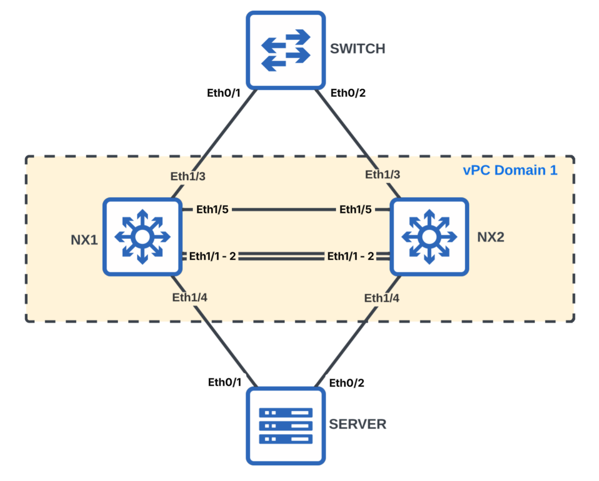
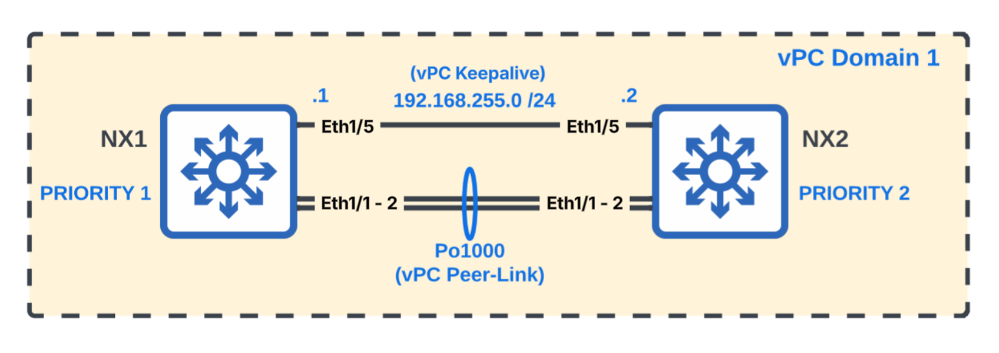
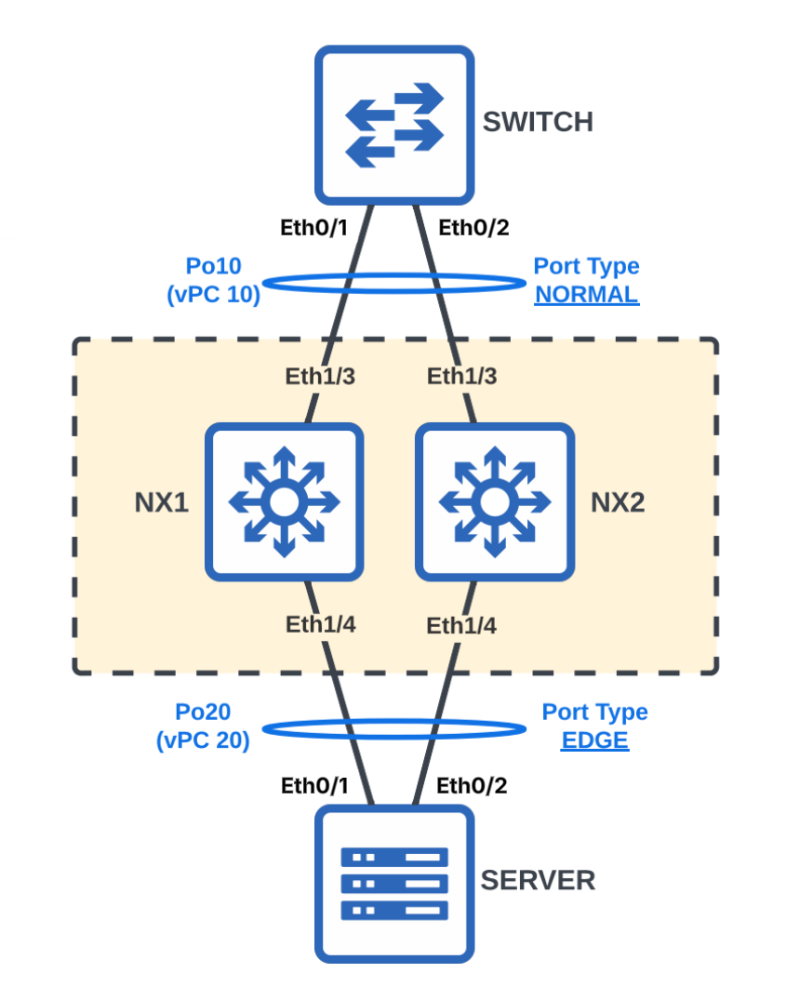
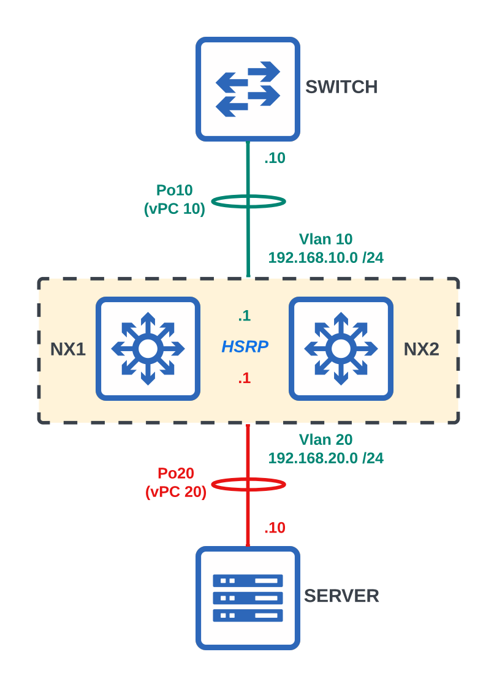

# Virtual Port Channel (vPC)





## vPC Peer Keepalive Connectivity

### Task 1. Configure the vPC Peer Keepalive interfaces with their assigned VRF & IP addresses

```text
# NX1
configure terminal
vrf context VPC-KEEPALIVE

interface Ethernet1/5
 no switchport
 vrf member VPC-KEEPALIVE
 ip address 192.168.255.1/30
 no shutdown
end
```

```text
# NX2
configure terminal
vrf context VPC-KEEPALIVE

interface Ethernet1/5
 no switchport
 vrf member VPC-KEEPALIVE
 ip address 192.168.255.2/30
 no shutdown
end
```

## vPC Domain

### Task 2. Configure vPC domain 1 with the assigned peer-keepalive addresses and role priorities

```text
# NX1
configure terminal
feature vpc

vpc domain 1
 role priority 1
 peer-keepalive destination 192.168.255.2 source 192.168.255.1 vrf VPC-KEEPALIVE
end
```

```text
# NX2
configure terminal
feature vpc

vpc domain 1
 role priority 2
 peer-keepalive destination 192.168.255.1 source 192.168.255.2 vrf VPC-KEEPALIVE
end
```

## vPC Peer Link

### Task 3. Configure the vPC peer link using Port-Channel 1000

```text
# NX1 & NX2
configure terminal
feature lacp

interface Ethernet1/1 - 2
 switchport
 channel-group 1000 mode active

interface Port-channel1000
 switchport mode trunk
 spanning-tree port type network
 vpc peer-link
end
```

## Downstream vPCs



### Task 4. Configure vPC 10 toward SWITCH

Allow only VLAN 10 across the trunk.

```text
# NX1 & NX2
configure terminal
vlan 10
 name SWITCH

interface Ethernet1/3
 switchport
 channel-group 10 mode active
 no shutdown

interface Port-channel10
 switchport mode trunk
 switchport trunk allowed vlan 10
 vpc 10
end
```

### Task 5. Configure vPC 20 toward SERVER

Configure the port channel as an access interface in VLAN 20.

```text
# NX1 & NX2
configure terminal
vlan 20
 name SERVER

interface Ethernet1/4
 switchport
 channel-group 20 mode active
 no shutdown

interface Port-channel20
 switchport mode access
 switchport access vlan 20
 vpc 20
end
```

## Bridge Assurance and STP Port Types

### Task 6. Enable Bridge Assurance and configure the appropriate spanning-tree port types

```text
# NX1 & NX2
configure terminal
spanning-tree bridge assurance
end
```

Configure the switch-facing vPC as a normal port and the server-facing vPC as an edge port.

```text
# NX1 & NX2
configure terminal
interface Port-channel10
 spanning-tree port type normal

interface Port-channel20
 spanning-tree port type edge
end
```

## SVIs and HSRP



### Task 7. Create SVIs and enable HSRP active-active forwarding

Configure the vPC peer gateway and create HSRP groups for VLANs 10 and 20.

```text
# NX1
configure terminal
feature interface-vlan
feature hsrp

vpc domain 1
 peer-gateway

interface Vlan10
 no shutdown
 ip address 192.168.10.2/24
 hsrp version 2
 hsrp 10
  authentication text pa55w0rd
  preempt
  priority 200
  ip 192.168.10.1

interface Vlan20
 no shutdown
 ip address 192.168.20.2/24
 hsrp version 2
 hsrp 20
  authentication text pa55w0rd
  preempt
  priority 200
  ip 192.168.20.1
end
```

```text
# NX2
configure terminal
feature interface-vlan
feature hsrp

vpc domain 1
 peer-gateway

interface Vlan10
 no shutdown
 ip address 192.168.10.3/24
 hsrp version 2
 hsrp 10
  authentication text pa55w0rd
  preempt
  priority 150
  ip 192.168.10.1

interface Vlan20
 no shutdown
 ip address 192.168.20.3/24
 hsrp version 2
 hsrp 20
  authentication text pa55w0rd
  preempt
  priority 150
  ip 192.168.20.1
end
```

### Verification from SERVER

```text
# SERVER
ping 192.168.10.10
```

## HSRP Active-Active Forwarding

### Task 8. Test HSRP active-active forwarding

Examine the MAC address tables and HSRP state before changing the HSRP priorities.

```text
# NX1 & NX2
show mac address-table dynamic vlan 10
show mac address-table dynamic vlan 20
show hsrp group 10
show hsrp group 20
```

Lower NX1's HSRP priority for both VLANs so that NX2 becomes active.

```text
# NX1
configure terminal
interface Vlan10
 hsrp 10
  priority 100

interface Vlan20
 hsrp 20
  priority 100
end
```

Verify the new HSRP states and MAC address learning.

```text
# NX1 & NX2
show mac address-table dynamic vlan 10
show mac address-table dynamic vlan 20
show hsrp group 10
show hsrp group 20
```

Monitor the server-facing interface counters on both switches.

```text
# NX1 & NX2
watch show interface Ethernet1/4 counters
```

## Key Concepts

A **Virtual Port Channel (vPC)** allows links connected to two separate Nexus switches to operate as a single logical port channel. This provides link and device redundancy while allowing all member links to remain active.

This lab demonstrates the following vPC technologies:

* **Management Interface and VRF** provide separate connectivity for the vPC peer-keepalive messages.
* **vPC Domain** joins the two Nexus switches into the same vPC system. Role priority determines which switch is preferred as the vPC primary peer.
* **Peer Keepalive** verifies that the remote vPC peer remains operational and helps detect peer failures.
* **vPC Peer Link** synchronizes state and carries traffic between the vPC peers when required.
* **Downstream vPCs** allow a switch or server to form a single port channel across both Nexus switches.
* **Bridge Assurance** protects network-facing links by blocking a port if expected BPDUs are no longer received.
* **STP Port Types** identify network-facing, normal, and edge connections so spanning tree can apply the appropriate behavior.
* **SVIs and HSRP** provide redundant Layer 3 default gateways for VLANs 10 and 20.
* **Peer Gateway** allows either vPC peer to locally forward traffic addressed to the other peer's router MAC, providing active-active forwarding even though each HSRP group still has an active and standby router.
